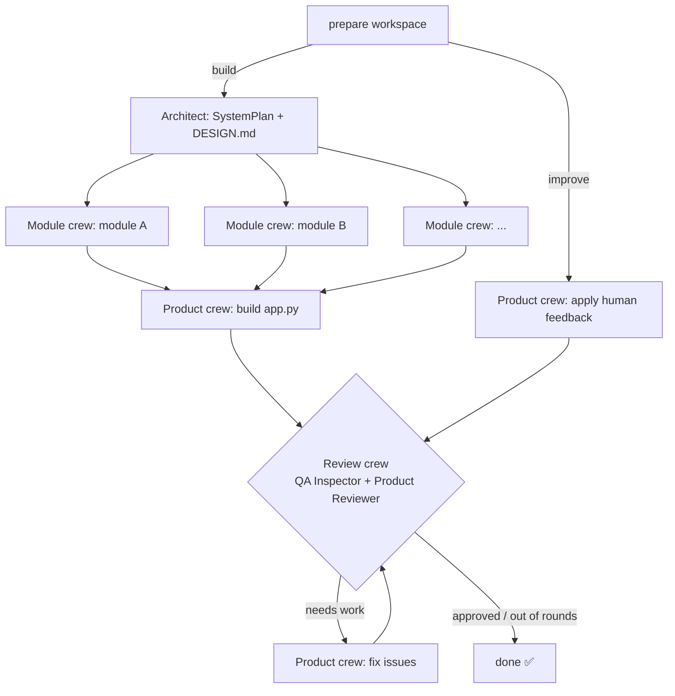

# 🛠️ Engineering Crew Studio

An AI engineering team built with [CrewAI](https://crewai.com) that **designs, builds, tests, reviews and keeps improving** small Python + Gradio products. You give it business requirements and feedback, and it ships working code.

The project started as the *engineering team* exercise from the CrewAI section of the [Agents course](https://github.com/ed-donner/agents) and goes on to complete every part of the extension challenge:

| Challenge | How it is done here |
|---|---|
| Hierarchical process with the **Engineering Lead as manager** | `module_crew` and `product_crew` use `Process.hierarchical` with `manager_agent=Engineering Lead`. The lead has no tools of its own. It decides who does what, delegates, checks the evidence and sends work back. |
| New roles: **quality inspection + feedback**, looping until satisfied | A **Quality Inspector** (read and run tools only, so it can't quietly patch things) and a **Product Reviewer** return a structured `ReviewVerdict`. The flow loops review → fix → review until it is approved or the round budget runs out. |
| **Human feedback** without wiping the sandbox | Each product lives in a persistent `workspaces/<name>/` uv project. `improve` mode keeps every file, applies your feedback, re-tests, re-reviews, and records it all in `CHANGELOG.md`. |
| **Gradio UI** for running the crew | `uv run studio-ui` lets you write requirements, watch the team live, give feedback, browse the code and reviews, and launch the generated app with one click. |
| **Flows** that run **multiple crews in parallel** | `StudioFlow` plans the system into modules, then runs **one hierarchical crew per module concurrently**, grouped into dependency waves. After that it integrates the UI and runs the review loop. |

## How it works



### The team (all on `gpt-5.4-mini`)

| Agent | Crew | Tools |
|---|---|---|
| Engineering Lead (**manager**) | module / product crews | delegation only |
| Software Architect | planning | Context7 (latest Gradio docs) |
| Backend Engineer | module / product | read, write, edit, run python, unit tests |
| Frontend Engineer | product | same as backend + smoke test + Context7 |
| Test Engineer | module / product | same as backend + smoke test |
| Quality Inspector | review | read, run tests, smoke test (**no write**) |
| Product Reviewer | review | read, run tests, smoke test (**no write**) → `ReviewVerdict` |

### Guard rails that make the output reliable

- **UI smoke test** (`smoke_test_app`). It builds `app.py` without launching it, calls every event handler with the default values, and fails if a handler raises or returns a different number of values than it has outputs. That is exactly the bug that makes every Gradio box show **"Error"**.
- **Sandboxed execution.** Code runs in Docker (`ghcr.io/astral-sh/uv`) when Docker is available and falls back to local `uv run`. The container gets its own venv, so the host `.venv` stays untouched.
- **Flat, safe workspace.** No folders, no path traversal, and `pyproject.toml`/`uv.lock` are protected.
- **Cost limits.** One cheap model everywhere, `max_iter` caps on every agent, and a review-round budget (default 2).

## Setup

Requirements: Python 3.12+, [uv](https://docs.astral.sh/uv/), and optionally Docker.

```bash
git clone <your-repo-url> engineering-crew-studio
cd engineering-crew-studio
cp .env.example .env        # then put your OPENAI_API_KEY in .env
uv sync
```

## Usage

### Gradio studio (recommended)

```bash
uv run studio-ui
```

1. **Build:** pick an example or write requirements, then click *Build product*.
2. **Workspace:** read the code, the latest review and the changelog. Click *Launch app* to try the product.
3. **Iterate:** write feedback (for example "add a chart of portfolio value over time"), then click *Improve product*.

### Command line

```bash
uv run studio-build   --project trading --requirements examples/trading_account.md
uv run studio-improve --project trading --feedback "Add CSV export of the transaction history"
cd workspaces/trading && uv run app.py   # run the generated product
uv run studio-plot                        # writes studio_flow.html (flow diagram)
```

### Tests (offline, no API cost)

```bash
uv run python -m unittest discover -s tests -v
```

These tests check the flow wiring (parallel waves, review loop, round limit, improve mode keeping files) with fake crews, and check that the smoke harness catches the output-count bug.

## Configuration (`.env`)

| Variable | Default | Meaning |
|---|---|---|
| `STUDIO_MODEL` | `openai/gpt-5.4-mini` | Model for every agent |
| `STUDIO_MAX_REVIEW_ROUNDS` | `2` | Automatic review → fix rounds |
| `STUDIO_RUNNER` | `auto` | `docker`, `local` or `auto` |
| `STUDIO_USE_CONTEXT7` | `1` | Live Gradio docs for the architect and frontend engineer |
| `STUDIO_AGENT_MAX_ITER` / `STUDIO_MANAGER_MAX_ITER` | `25` / `20` | Per-agent iteration caps |

## Project layout

```
src/crew_studio/
  config/agents.yaml   role, goal and backstory for the 7 agents
  config/tasks.yaml    task prompts (planning, module, product, review)
  crews.py             planning / module (hierarchical) / product (hierarchical) / review crews
  flow.py              StudioFlow: plan → parallel module crews → UI → review loop
  workspace.py         persistent per-product uv workspaces + Docker/local runner
  tools/               workspace-bound tools + UI smoke-test harness
  progress.py          live activity feed (CrewAI event bus → UI)
  ui.py                Gradio studio
  main.py              CLI entry points
examples/              sample requirements
tests/                 offline tests
workspaces/            generated products (git-ignored)
```
