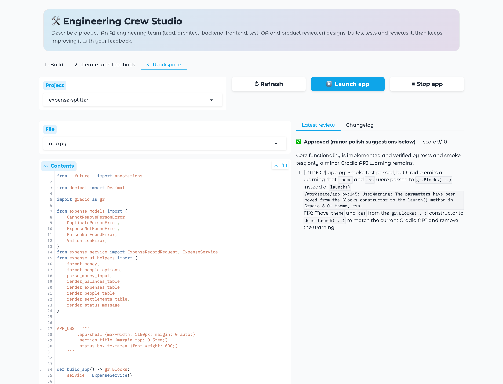
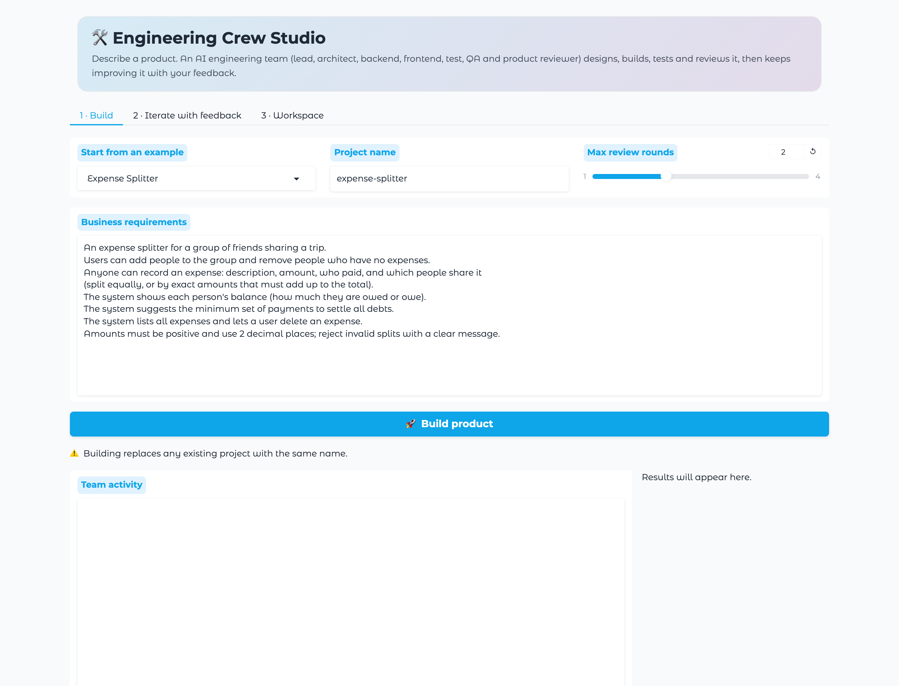
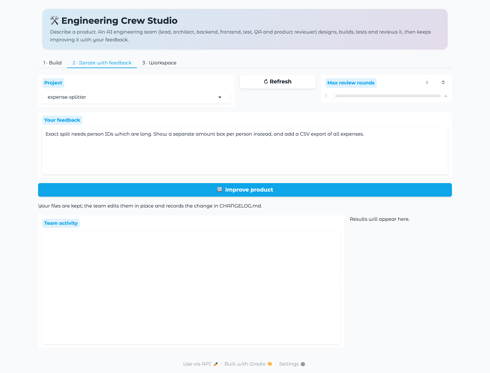
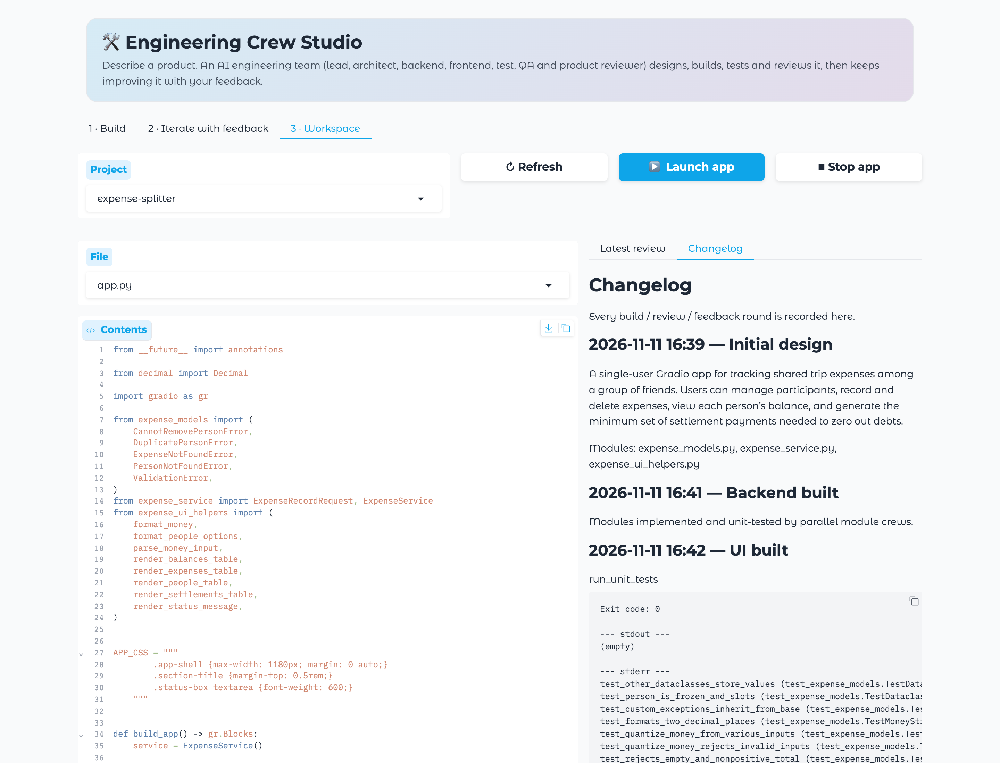
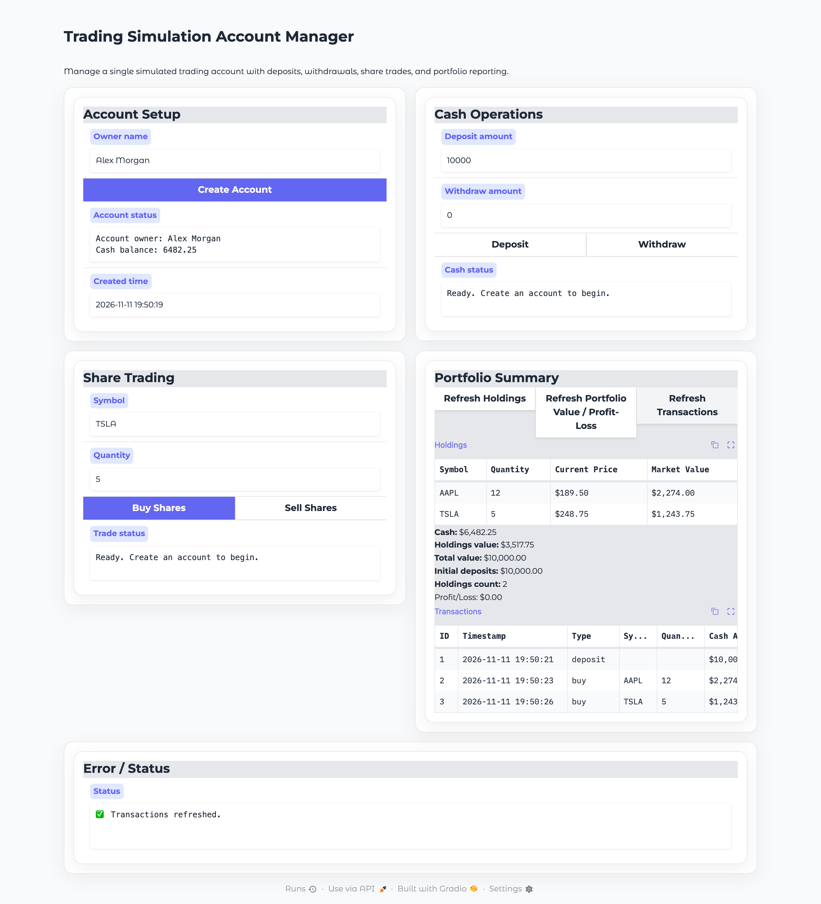
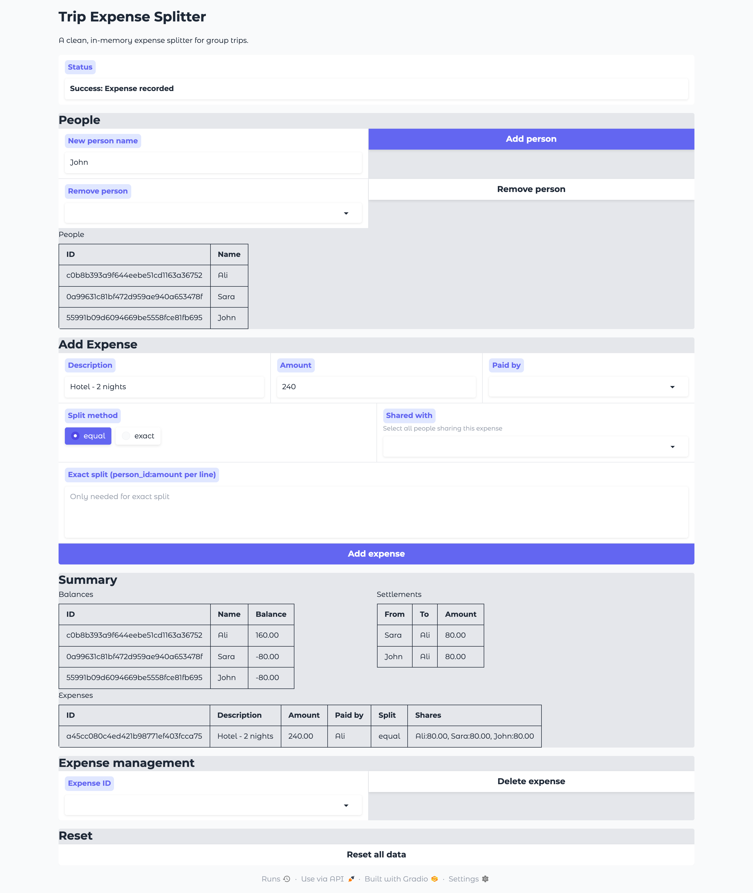
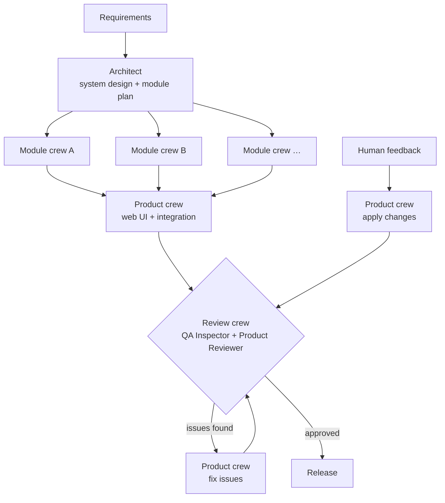

# Engineering Crew Studio

**An autonomous AI engineering team that turns business requirements into working, tested software.**

Engineering Crew Studio is a multi-agent system built on [CrewAI](https://crewai.com). You describe a product in plain English. A team of specialised AI agents then designs it, implements it in parallel, writes and runs unit tests, builds a web UI, reviews the result against your requirements, and keeps improving it until it meets the bar. You can then give feedback and the same team keeps working on the existing codebase.




---

## Screenshots

### The studio

| 1 · Build | 2 · Iterate with feedback |
|---|---|
|  |  |
| Write the business requirements (or start from an example), set the review budget, and click **Build product**. The team's activity streams live underneath. | Pick an existing product and describe what to change. The team edits the code in place, re-tests it, and re-reviews it. |

| 3 · Workspace: code + review | 3 · Workspace: changelog |
|---|---|
|  |  |
| Browse every generated file, read the reviewers' structured verdict, and launch the product with one click. | Every design, build, review and feedback round is recorded in `CHANGELOG.md`. |

### Products the team built

Both apps below were generated by the studio from the requirement files in `examples/`. The team designed, coded and tested them.

| Trading account simulator | Trip expense splitter |
|---|---|
|  |  |
| `examples/trading_account.md`: 3 modules, 34 unit tests, 2 review rounds (only minor polish items left open) | `examples/expense_splitter.md`: 3 modules, 42 unit tests, approved after 1 review round |

Building the expense splitter exposed a UI wiring bug: a `gr.update(choices=…)` was sent to a Textbox, so every output showed "Error". It was fixed by hand, and the UI smoke test was extended so the team now catches this class of bug on its own.

### Live team activity

While the team works, the studio streams what each agent is doing. This excerpt is from a real build:

```text
[15:59:46] 📐 Plan ready: Trading Simulation Account Manager → modules: trading_models.py, trading_account.py, price_lookup.py
[15:59:46] ⚡ Wave 1/2: building trading_models.py, price_lookup.py in parallel
[15:59:48] 📨 Engineering Lead → delegates to Backend Engineer: Implement the module price_lookup …
[15:59:50] 📨 Engineering Lead → delegates to Backend Engineer: Implement the module trading_models.py …
[15:59:52] 🔧 Backend Engineer: write_file(price_lookup.py)
[15:59:53] 🔧 Backend Engineer: write_file(trading_models.py)
[16:00:46] 📨 Engineering Lead → delegates to Test Engineer: Read DESIGN.md and price_lookup.py. Write test_price_lookup.py …
[16:00:50] 🔧 Test Engineer: run_unit_tests
[16:00:53] ✅ Module crew finished price_lookup.py
[16:01:20] ✅ Module crew finished trading_models.py
[16:01:20] ⚡ Wave 2/2: building trading_account.py in parallel
[16:01:59] 🎨 Engineering Lead is directing the UI build…
[16:02:02] 📨 Engineering Lead → delegates to Frontend Engineer: Implement the Gradio UI in app.py …
[16:02:15] 🔧 Frontend Engineer: smoke_test_app
[16:02:55] 🔎 Quality review round 1/2…
[16:02:56] 🔧 Quality Inspector: run_unit_tests
[16:03:18] 🔎 Verdict: changes requested (8/10)
```

---

## Features

- **Hierarchical team management.** An Engineering Lead agent manages the team. It breaks the work down, delegates to the right engineer, checks the evidence each engineer returns, and sends work back until it is done.
- **Parallel development.** The system design is split into independent modules. Each module is built by its own crew, and crews run concurrently in dependency-aware waves.
- **Built-in quality gate.** A Quality Inspector and a Product Reviewer check every build. They run the tests, exercise the UI, and check each requirement. Any blocker or major issue goes back to the team automatically.
- **Iterative, human-in-the-loop workflow.** Projects persist between runs. You review the product, give feedback, and the team edits the existing code instead of starting over. Every change is recorded in a changelog.
- **Web studio.** A Gradio interface for writing requirements, watching the agents work live, browsing the generated code and reviews, launching the product, and sending feedback.
- **Sandboxed execution.** Generated code runs inside Docker containers, with an automatic fallback to isolated local environments.
- **Bring your own LLM.** Run the team on OpenAI, Claude, OpenRouter (hundreds of models), Grok, Gemini, DeepSeek or a local Ollama model, and optionally give the Engineering Lead a stronger model than the engineers.
- **Cost-aware by design.** One lightweight model powers the team by default, with iteration caps per agent and a configurable review budget.

---

## How it works



The orchestration is a **CrewAI Flow** (`StudioFlow`) that coordinates four kinds of crews:

| Crew | Process | Responsibility |
|---|---|---|
| Planning | Sequential | Turns requirements into a structured plan (`SystemPlan`) and a design document |
| Module | Hierarchical | Implements and unit-tests one backend module; one crew per module, run in parallel |
| Product | Hierarchical | Builds the UI, applies review findings and human feedback, verifies the release |
| Review | Sequential | Inspects quality and returns a structured verdict (`ReviewVerdict`) |

### The team

| Agent | Role | Capabilities |
|---|---|---|
| **Engineering Lead** | Manager of the module and product crews | Delegation only, with no direct file access |
| **Software Architect** | System design and module boundaries | Live framework documentation via Context7 MCP |
| **Backend Engineer** | Business logic in pure Python | Read, write, edit and execute code; run tests |
| **Frontend Engineer** | Gradio user interface | Same as backend, plus UI verification and live docs |
| **Test Engineer** | Unit tests and defect fixing | Same as backend, plus UI verification |
| **Quality Inspector** | Independent verification | Read-only: inspect, run tests, verify UI |
| **Product Reviewer** | Release decision | Read-only; produces the final structured verdict |

Reviewers are intentionally read-only. They have to report problems rather than patch them quietly, which keeps the review honest.

### Quality safeguards

- **Automated UI verification.** Every generated interface is built headlessly, and each event handler is called with default inputs. The check fails when a handler raises, returns the wrong number of values, or sends an update a component cannot accept. These are the most common reasons a Gradio app shows "Error" in the browser.
- **Deterministic release rule.** A product is approved only when there are no blocker or major findings. Cosmetic suggestions never block a release.
- **Safe workspace.** File access is limited to a flat project directory, path traversal is rejected, and project configuration files are protected.

---

## Getting started

### Prerequisites

- Python 3.12 or 3.13
- [uv](https://docs.astral.sh/uv/)
- An API key for any supported LLM provider (or a local Ollama install)
- Docker (optional, recommended for sandboxed execution)

### Installation

```bash
git clone https://github.com/<your-username>/engineering-crew-studio.git
cd engineering-crew-studio
cp .env.example .env    # choose STUDIO_PROVIDER and add that provider's key
uv sync
```

---

## Usage

### Web studio

```bash
uv run studio-ui
```

1. **Build:** write your requirements (or start from an example) and click **Build product**.
2. **Workspace:** browse the generated code, the latest review and the changelog. Click **Launch app** to try the product.
3. **Iterate:** describe what to change and click **Improve product**. The team updates the existing code, re-tests it and re-reviews it.

### Command line

```bash
# Build a new product from a requirements file
uv run studio-build --project trading --requirements examples/trading_account.md

# Improve an existing product with feedback
uv run studio-improve --project trading --feedback "Add CSV export of the transaction history"

# Run the generated product
cd workspaces/trading && uv run app.py

# Render the orchestration flow as an interactive diagram
uv run studio-plot
```

### Example requirements

The `examples/` folder includes ready-to-use specifications:

| Example | Description |
|---|---|
| `trading_account.md` | Trading simulation account with portfolio valuation and P/L |
| `expense_splitter.md` | Group expense tracking with balances and settlement suggestions |
| `habit_tracker.md` | Habit tracking with streaks and completion rates |

---

## Choose your LLM provider

Set `STUDIO_PROVIDER` in `.env` and add that provider's key. All seven agents switch together.

| Provider | `STUDIO_PROVIDER` | Key | Default model |
|---|---|---|---|
| OpenAI | `openai` | `OPENAI_API_KEY` | `gpt-5.4-mini` |
| Anthropic Claude | `anthropic` | `ANTHROPIC_API_KEY` | `claude-opus-5-5` |
| OpenRouter | `openrouter` | `OPENROUTER_API_KEY` | `openai/gpt-5.4-mini` |
| xAI Grok | `grok` | `XAI_API_KEY` | `grok-4.7` |
| Google Gemini | `gemini` | `GEMINI_API_KEY` | `gemini-2.5-flash` |
| DeepSeek | `deepseek` | `DEEPSEEK_API_KEY` | `deepseek-chat` |
| Ollama (local) | `ollama` | none | `llama3.2` |

**Examples**

```bash
# Claude through Anthropic's API
STUDIO_PROVIDER=anthropic
ANTHROPIC_API_KEY=sk-ant-...
STUDIO_MODEL=claude-haiku-5-5            # optional: faster, lower-cost Claude for the team

# Any model through one OpenRouter key: Claude, GPT, Grok, Llama, Mistral...
STUDIO_PROVIDER=openrouter
OPENROUTER_API_KEY=sk-or-...
STUDIO_MODEL=anthropic/claude-haiku-5.5

# Cheap engineers, stronger lead and architect
STUDIO_PROVIDER=openai
STUDIO_MODEL=gpt-5.4-mini
STUDIO_MANAGER_MODEL=gpt-5.4
```

Claude, Gemini, OpenRouter, DeepSeek and Ollama use CrewAI's native providers. Grok is connected through xAI's OpenAI-compatible API. The model in use is printed at the start of every run in the activity feed. If `STUDIO_MODEL` still names a model from a different provider after you switch, it is ignored and the new provider's default is used.

---

## Configuration

All settings are read from `.env`:

| Variable | Default | Description |
|---|---|---|
| `STUDIO_PROVIDER` | `openai` | `openai`, `anthropic`, `openrouter`, `grok`, `gemini`, `deepseek`, `ollama` |
| Provider key | none | Required, e.g. `OPENAI_API_KEY` or `ANTHROPIC_API_KEY` (see table above) |
| `STUDIO_MODEL` | provider default | Model used by the team |
| `STUDIO_MANAGER_MODEL` | `STUDIO_MODEL` | Model for the Engineering Lead and Software Architect |
| `STUDIO_MAX_TOKENS` | `8192` | Output cap per call for non-OpenAI providers |
| `STUDIO_MAX_REVIEW_ROUNDS` | `2` | Maximum automatic review → fix cycles per run |
| `STUDIO_RUNNER` | `auto` | Code execution: `docker`, `local` or `auto` |
| `STUDIO_USE_CONTEXT7` | `1` | Live framework documentation for the architect and frontend engineer |
| `STUDIO_AGENT_MAX_ITER` | `25` | Iteration cap per agent |
| `STUDIO_MANAGER_MAX_ITER` | `20` | Iteration cap for the Engineering Lead |
| `APP_USERNAME`, `APP_PASSWORD` | none | Login screen for hosted deployments |

---

## Deployment

The studio ships as a container image that includes `uv`, which it needs to create each product's own project. Inside the container it runs generated code locally (`STUDIO_RUNNER=local`), isolated from the host. It keeps generated products in `/data/workspaces`.

Hosting the studio has three requirements:

1. **A login.** Set `APP_USERNAME` and `APP_PASSWORD`. Every build spends your LLM credits and runs generated code, so never expose it publicly without them.
2. **Persistent storage** for `/data`, so products survive restarts and you can keep iterating on them.
3. **No short request timeouts.** A full build takes several minutes, which rules out platforms that cut requests after a minute or two.

### Where to host it

| Platform | Fit | Notes |
|---|---|---|
| **AWS EC2 / Lightsail** | ✅ Recommended | Persistent disk, no time limits, full control |
| **AWS ECS on Fargate + EFS** | ✅ Managed AWS | Mount EFS at `/data`; put an Application Load Balancer in front with a long idle timeout |
| **Railway / Fly.io / Render (paid)** | ✅ Simple | Attach a volume at `/data` |
| **Hugging Face Spaces** | ⚠️ Demos | Use a private Space with persistent storage and upgraded hardware |
| **AWS App Runner / Google Cloud Run** | ❌ Not a good fit | Request time limits and ephemeral disk interrupt long builds |

The **Launch app** button starts a generated product on an internal port, which hosted setups don't expose. On a server, use the Workspace tab to review the code, or run a product from its folder in `/data/workspaces`.

### Run with Docker (any server)

```bash
docker build -t engineering-crew-studio .
docker run -d --name studio -p 7860:7860 --env-file .env \
  -e APP_USERNAME=admin -e APP_PASSWORD='choose-a-strong-password' \
  -v studio-data:/data engineering-crew-studio
# open http://localhost:7860 and sign in
```

### AWS: EC2 or Lightsail (recommended)

Use an Ubuntu instance with at least 4 GB RAM and 30 GB of disk (each product gets its own Python environment), with ports 80 and 443 open:

```bash
sudo apt-get update && sudo apt-get install -y docker.io git caddy
git clone https://github.com/<your-username>/engineering-crew-studio.git && cd engineering-crew-studio
cp .env.example .env && nano .env           # provider + key, APP_USERNAME, APP_PASSWORD
sudo docker build -t engineering-crew-studio .
sudo docker run -d --restart unless-stopped --name studio \
  -p 127.0.0.1:7860:7860 --env-file .env -v studio-data:/data engineering-crew-studio

# Free HTTPS for your domain (point an A record at the instance first)
echo 'studio.yourdomain.com {
  reverse_proxy 127.0.0.1:7860
}' | sudo tee /etc/caddy/Caddyfile
sudo systemctl reload caddy
```

To update later: `git pull`, rebuild, then `docker rm -f studio` and run the same command. The `studio-data` volume keeps every product.

### AWS: ECS on Fargate (managed)

1. Build for `linux/amd64` and push to Amazon ECR:

   ```bash
   AWS_REGION=us-east-1
   ACCOUNT=$(aws sts get-caller-identity --query Account --output text)
   REPO=$ACCOUNT.dkr.ecr.$AWS_REGION.amazonaws.com/engineering-crew-studio

   aws ecr create-repository --repository-name engineering-crew-studio --region $AWS_REGION
   aws ecr get-login-password --region $AWS_REGION | docker login --username AWS --password-stdin $ACCOUNT.dkr.ecr.$AWS_REGION.amazonaws.com
   docker buildx build --platform linux/amd64 -t $REPO:latest --push .
   ```

2. Create an **EFS** file system and an **ECS task definition** that uses the image, exposes port **7860**, mounts EFS at `/data`, and reads the keys and `APP_PASSWORD` from **Secrets Manager** (2 vCPU / 4 GB is a good start).
3. Run it as an ECS service behind an **Application Load Balancer** with an HTTPS listener. Raise the ALB idle timeout (for example to 600 seconds) so live progress streams aren't cut during long builds.

---

## Generated project structure

Each product lives in its own self-contained uv project:

```
workspaces/<project>/
├── REQUIREMENTS.md     # your requirements
├── DESIGN.md           # architecture by the Software Architect
├── CHANGELOG.md        # every build, review and feedback round
├── <module>.py         # backend modules
├── test_<module>.py    # unit tests
├── app.py              # Gradio application
└── .studio/            # plan, review verdicts and run metadata
```

---

## Repository layout

```
src/crew_studio/
├── config/
│   ├── agents.yaml     # agent roles, goals and backstories
│   └── tasks.yaml      # task definitions
├── tools/
│   ├── workspace_tools.py   # file, execution and test tools
│   └── smoke_harness.py     # automated UI verification
├── settings.py         # configuration and LLM provider selection
├── crews.py            # planning, module, product and review crews
├── flow.py             # StudioFlow orchestration
├── models.py           # structured outputs (SystemPlan, ReviewVerdict)
├── workspace.py        # project workspaces and sandboxed runner
├── progress.py         # live activity feed from CrewAI events
├── ui.py               # Gradio web studio
└── main.py             # CLI entry points
examples/               # sample requirement specifications
tests/                  # offline test suite
docs/screenshots/       # images used in this README
Dockerfile              # container image for EC2, ECS, Railway, Fly.io...
```

---

## Testing

The test suite runs fully offline and makes no LLM calls:

```bash
uv run python -m unittest discover -s tests -v
```

It covers flow orchestration (parallel waves, the review loop, round limits, iterative mode), the release rule, workspace safety, and the UI verification harness.

---

## Tech stack

- **[CrewAI](https://crewai.com)** for agents, crews, hierarchical processes and flows
- **OpenAI, Anthropic, Gemini, OpenRouter, xAI, DeepSeek, Ollama** as interchangeable LLM providers
- **[Gradio](https://gradio.app)** for the studio interface and the generated product UIs
- **[uv](https://docs.astral.sh/uv/)** for dependency and environment management
- **[Docker](https://www.docker.com/)** for sandboxed code execution
- **[Context7 MCP](https://context7.com)** for up-to-date framework documentation

---

## License

Released under the MIT License.
