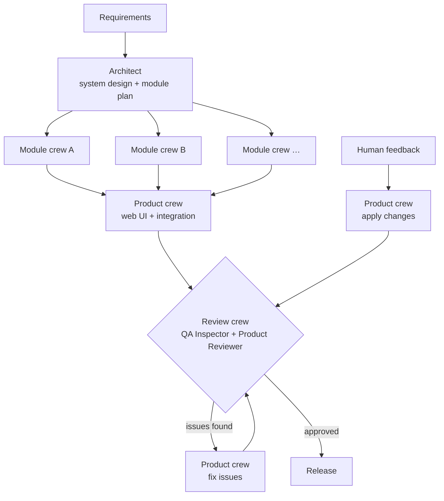

# Engineering Crew Studio

**An autonomous AI engineering team that turns business requirements into working, tested software.**

Engineering Crew Studio is a multi-agent system built on [CrewAI](https://crewai.com). You describe a product in plain English. A team of specialised AI agents then designs it, implements it in parallel, writes and runs unit tests, builds a web UI, reviews the result against your requirements, and keeps improving it until it meets the bar. You can then give feedback and the same team keeps working on the existing codebase.


---

## Features

- **Hierarchical team management.** An Engineering Lead agent manages the team. It breaks the work down, delegates to the right engineer, checks the evidence each engineer returns, and sends work back until it is done.
- **Parallel development.** The system design is split into independent modules. Each module is built by its own crew, and crews run concurrently in dependency-aware waves.
- **Built-in quality gate.** A Quality Inspector and a Product Reviewer check every build. They run the tests, exercise the UI, and check each requirement. Any blocker or major issue goes back to the team automatically.
- **Iterative, human-in-the-loop workflow.** Projects persist between runs. You review the product, give feedback, and the team edits the existing code instead of starting over. Every change is recorded in a changelog.
- **Web studio.** A Gradio interface for writing requirements, watching the agents work live, browsing the generated code and reviews, launching the product, and sending feedback.
- **Sandboxed execution.** Generated code runs inside Docker containers, with an automatic fallback to isolated local environments.
- **Cost-aware by design.** One lightweight model powers every agent, with iteration caps per agent and a configurable review budget.

---

## How it works



The orchestration is a **CrewAI Flow** (`StudioFlow`) that coordinates four kinds of crews:

| Crew | Process | Responsibility |
|---|---|---|
| Planning | Sequential | Turns requirements into a structured plan (`SystemPlan`) and a design document |
| Module | Hierarchical | Implements and unit-tests one backend module; one crew per module, run in parallel |
| Product | Hierarchical | Builds the UI, applies review findings and human feedback, verifies the release |
| Review | Sequential | Inspects quality and returns a structured verdict (`ReviewVerdict`) |

### The team

| Agent | Role | Capabilities |
|---|---|---|
| **Engineering Lead** | Manager of the module and product crews | Delegation only, with no direct file access |
| **Software Architect** | System design and module boundaries | Live framework documentation via Context7 MCP |
| **Backend Engineer** | Business logic in pure Python | Read, write, edit and execute code; run tests |
| **Frontend Engineer** | Gradio user interface | Same as backend, plus UI verification and live docs |
| **Test Engineer** | Unit tests and defect fixing | Same as backend, plus UI verification |
| **Quality Inspector** | Independent verification | Read-only: inspect, run tests, verify UI |
| **Product Reviewer** | Release decision | Read-only; produces the final structured verdict |

Reviewers are intentionally read-only. They have to report problems rather than patch them quietly, which keeps the review honest.

### Quality safeguards

- **Automated UI verification.** Every generated interface is built headlessly, and each event handler is called with default inputs. The check fails when a handler raises, returns the wrong number of values, or sends an update a component cannot accept. These are the most common reasons a Gradio app shows "Error" in the browser.
- **Deterministic release rule.** A product is approved only when there are no blocker or major findings. Cosmetic suggestions never block a release.
- **Safe workspace.** File access is limited to a flat project directory, path traversal is rejected, and project configuration files are protected.

---

## Getting started

### Prerequisites

- Python 3.12 or 3.13
- [uv](https://docs.astral.sh/uv/)
- An OpenAI API key
- Docker (optional, recommended for sandboxed execution)

### Installation

```bash
git clone https://github.com/<your-username>/engineering-crew-studio.git
cd engineering-crew-studio
cp .env.example .env    # add your OPENAI_API_KEY
uv sync
```

---

## Usage

### Web studio

```bash
uv run studio-ui
```

1. **Build:** write your requirements (or start from an example) and click **Build product**.
2. **Workspace:** browse the generated code, the latest review and the changelog. Click **Launch app** to try the product.
3. **Iterate:** describe what to change and click **Improve product**. The team updates the existing code, re-tests it and re-reviews it.

### Command line

```bash
# Build a new product from a requirements file
uv run studio-build --project trading --requirements examples/trading_account.md

# Improve an existing product with feedback
uv run studio-improve --project trading --feedback "Add CSV export of the transaction history"

# Run the generated product
cd workspaces/trading && uv run app.py

# Render the orchestration flow as an interactive diagram
uv run studio-plot
```

### Example requirements

The `examples/` folder includes ready-to-use specifications:

| Example | Description |
|---|---|
| `trading_account.md` | Trading simulation account with portfolio valuation and P/L |
| `expense_splitter.md` | Group expense tracking with balances and settlement suggestions |
| `habit_tracker.md` | Habit tracking with streaks and completion rates |

---

## Configuration

All settings are read from `.env`:

| Variable | Default | Description |
|---|---|---|
| `OPENAI_API_KEY` | none | Required |
| `STUDIO_MODEL` | `openai/gpt-5.4-mini` | Model used by every agent |
| `STUDIO_MAX_REVIEW_ROUNDS` | `2` | Maximum automatic review → fix cycles per run |
| `STUDIO_RUNNER` | `auto` | Code execution: `docker`, `local` or `auto` |
| `STUDIO_USE_CONTEXT7` | `1` | Live framework documentation for the architect and frontend engineer |
| `STUDIO_AGENT_MAX_ITER` | `25` | Iteration cap per agent |
| `STUDIO_MANAGER_MAX_ITER` | `20` | Iteration cap for the Engineering Lead |

---

## Generated project structure

Each product lives in its own self-contained uv project:

```
workspaces/<project>/
├── REQUIREMENTS.md     # your requirements
├── DESIGN.md           # architecture by the Software Architect
├── CHANGELOG.md        # every build, review and feedback round
├── <module>.py         # backend modules
├── test_<module>.py    # unit tests
├── app.py              # Gradio application
└── .studio/            # plan, review verdicts and run metadata
```

---

## Repository layout

```
src/crew_studio/
├── config/
│   ├── agents.yaml     # agent roles, goals and backstories
│   └── tasks.yaml      # task definitions
├── tools/
│   ├── workspace_tools.py   # file, execution and test tools
│   └── smoke_harness.py     # automated UI verification
├── crews.py            # planning, module, product and review crews
├── flow.py             # StudioFlow orchestration
├── models.py           # structured outputs (SystemPlan, ReviewVerdict)
├── workspace.py        # project workspaces and sandboxed runner
├── progress.py         # live activity feed from CrewAI events
├── ui.py               # Gradio web studio
└── main.py             # CLI entry points
examples/               # sample requirement specifications
tests/                  # offline test suite
```

---

## Testing

The test suite runs fully offline and makes no LLM calls:

```bash
uv run python -m unittest discover -s tests -v
```

It covers flow orchestration (parallel waves, the review loop, round limits, iterative mode), the release rule, workspace safety, and the UI verification harness.

---

## Tech stack

- **[CrewAI](https://crewai.com)** for agents, crews, hierarchical processes and flows
- **[Gradio](https://gradio.app)** for the studio interface and the generated product UIs
- **[uv](https://docs.astral.sh/uv/)** for dependency and environment management
- **[Docker](https://www.docker.com/)** for sandboxed code execution
- **[Context7 MCP](https://context7.com)** for up-to-date framework documentation

---

## License

Released under the MIT License.
